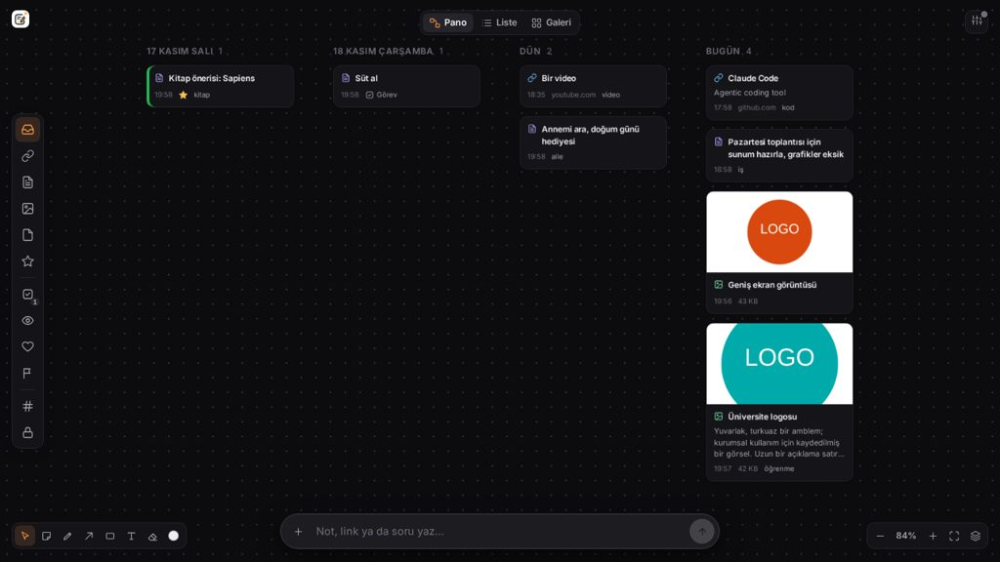
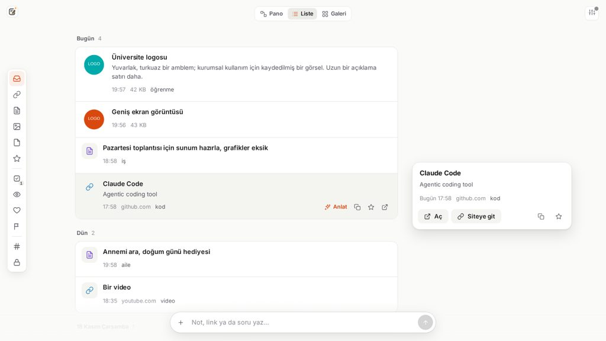
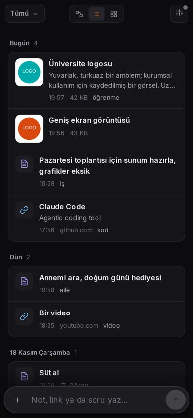

<div align="center">


# Nts

Kendine attığın link, not, foto ve dosyalar tek yerde. Claude düzenler, sen sorarsın.

[](https://mohamedattiadev.github.io/nts/)
[](#kurulum)



</div>

## Ne yapar
- **Tek kutu:** yaz, link ya da resim yapıştır, dosya bırak, **Enter** kaydeder. Yazarken kayıtlarının arasında da arar.
- **Claude'a sor:** kutuda **Tab** ile "Sor" moduna geç: "geçen hafta kaydettiğim PDF neydi?". Claude yeni kayıtlara başlık, özet, konu koyar, görevleri ve listeleri doldurur.
- **Görünümler:** Pano (sürükle, çiz, not yapıştır), Liste, Galeri, Yapılacaklar. Word, Excel, PowerPoint, PDF, Markdown içinde önizleme.
- **Telefon + bilgisayar:** ikisinde de Google ile gir, kayıtlar anında senkron. Android'de herhangi bir uygulamadan **Paylaş → Nts**.
- **Şifrelerim:** ayrı ana şifreli kasa, cihazda şifrelenir, Claude ve arama içini görmez.

<p align="center"> </p>

## Kurulum
Bilgisayarda (Linux, Node.js 20+, [Claude Code](https://claude.com/claude-code) girişli) tek komut:

```bash
curl -fsSL https://raw.githubusercontent.com/Mohamedattiadev/nts/main/install.sh | bash
```

Bu komut şunları kurar: Claude köprüsü (arka plan servisi), `nts` komutu, dosya yöneticisinde "Nts'a gönder", Claude Code için Nts MCP sunucusu ve telefon erişimi.

Sonra **http://localhost:8787** adresini aç ve Google ile gir. Telefonda aynı Google hesabıyla girince Claude kendiliğinden bağlanır: bilgisayar açıkken istekler Supabase üzerinden şifreli gider, Tailscale gerekmez.

```bash
nts "bir not ya da https://link"   # metin
nts rapor.pdf foto.jpg            # dosyalar
nts --clip                        # panodaki metin, resim ya da dosyalar
```

<details><summary><b>Gizlilik</b></summary>

- github.io'da sadece uygulamanın kodu var. Kayıtların cihazında ve kendi Google hesabına bağlı senkronda durur; başkası siteyi açarsa boş bir uygulama görür.
- Ayarlar → Hesap → **Şifre koy**: uygulama açılırken şifre sorar, sunucuya giden her şey AES-256-GCM ile şifrelenir.
- Claude senin aboneliğinle, senin bilgisayarındaki `claude` üzerinden çalışır; kayıtların başka bir sunucuya gitmez.

</details>
